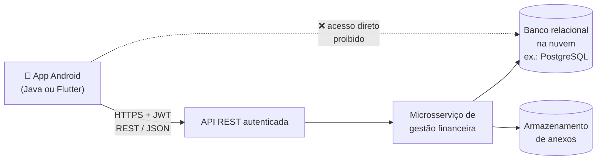
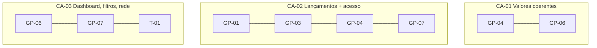

# Requisitos — Opção 1: Aplicativo de Gestão Financeira de Projetos Científicos

> **Fonte:** *Requisitos para Desenvolvimento de Aplicativos Android* (Opção 1 + premissas, entregáveis e decisões comuns às três opções).
> **Uso:** checklist de validação do projeto. Cada item pode ser marcado `[x]` quando comprovado (tela, código, teste ou documentação).
> **Legenda:** os textos em **negrito** vêm literalmente do PDF; os subitens `a)`, `b)`… são a decomposição do requisito em pontos verificáveis.

---

## 1. Objetivo

Permitir a **pesquisadores, coordenadores e equipes autorizadas** consultar e registrar a **execução orçamentária de projetos de pesquisa**, com base nas rubricas e demonstrativos exemplificados na planilha e no painel financeiro fornecidos (ver seção 9).

---

## 2. Premissas comuns (valem para a Opção 1)

| # | Premissa | OK |
|---|----------|----|
| P-01 | O produto principal é um **aplicativo Android instalável (APK/AAB)**, com interface adaptada a **smartphones** | [ ] |
| P-02 | Tecnologia: **Android nativo em Java** *ou* **Flutter/Dart** (a definir pelo grupo) | [ ] |
| P-03 | O backend é consumido por **APIs seguras**; o app **não acessa o banco de dados diretamente** | [ ] |
| P-04 | **Autenticação com JWT** e perfis de acesso conforme a necessidade do projeto | [ ] |
| P-05 | Tráfego **HTTPS** | [ ] |
| P-06 | **Tratamento de erros** | [ ] |
| P-07 | **Indicadores de carregamento** (loading) | [ ] |
| P-08 | **Proteção de credenciais** (ex.: token/senha não expostos nem em texto puro no dispositivo, nem em logs) | [ ] |

---

## 3. Requisitos funcionais

### GP-01 — Login, seleção de projeto e permissões
**Login e seleção de projeto; permissões de coordenador, gestor e usuário de consulta.**

- [ ] a) Tela de login com autenticação via API (JWT)
- [ ] b) Tela/fluxo de **seleção de projeto** após o login
- [ ] c) Três perfis implementados: **coordenador**, **gestor** e **usuário de consulta**
- [ ] d) Controle de acesso aplicado na interface (ex.: usuário de consulta **não** vê botões de criar/editar)
- [ ] e) Controle de acesso refletido nas chamadas à API (o servidor também restringe)
- [ ] f) Logout / tratamento de token expirado ou inválido

### GP-02 — Cadastro e consulta de projetos
**Cadastro/consulta de projetos, vigência, fonte de recursos, responsáveis e orçamento aprovado.**

- [ ] a) Listagem de projetos
- [ ] b) Detalhe do projeto exibindo: **vigência**, **fonte de recursos**, **responsáveis** e **orçamento aprovado**
- [ ] c) Cadastro de projeto (nos perfis autorizados)
- [ ] d) Edição de projeto (nos perfis autorizados), com confirmação (ver GP-09)

### GP-03 — Rubricas e subrubricas
**Cadastro de rubricas e subrubricas: diárias, passagens, material de consumo, serviços de terceiros, material permanente e outras configuráveis.**

- [ ] a) Cadastro e consulta de **rubricas** por projeto
- [ ] b) Cadastro e consulta de **subrubricas** vinculadas a uma rubrica
- [ ] c) Rubricas previstas: **Diárias**, **Passagens**, **Material de consumo**, **Serviços de terceiros**, **Material permanente**
- [ ] d) Possibilidade de criar **outras rubricas configuráveis** (não fixas no código)
- [ ] e) Valor orçado por rubrica (necessário para GP-06 e GP-10)

### GP-04 — Lançamento de receitas e despesas
**Lançamento de receitas e despesas com data, descrição, rubrica, quantidade, valor unitário, valor total e situação.**

- [ ] a) Cadastro de **receita**
- [ ] b) Cadastro de **despesa**
- [ ] c) Campos obrigatórios presentes: **data**, **descrição**, **rubrica**, **quantidade**, **valor unitário**, **valor total**, **situação**
- [ ] d) **Valor total = quantidade × valor unitário** (cálculo coerente)
- [ ] e) Consulta/listagem dos lançamentos por projeto e rubrica
- [ ] f) Edição de lançamento existente

### GP-05 — Comprovantes (opcional)
**Inclusão opcional de comprovantes por foto ou arquivo, enviados à API e associados ao lançamento.**

- [ ] a) Anexar comprovante **por foto** (câmera)
- [ ] b) Anexar comprovante **por arquivo** (seletor de arquivos)
- [ ] c) Envio do arquivo **à API** (não fica só local)
- [ ] d) Comprovante **associado ao lançamento** correspondente
- [ ] e) O lançamento pode ser salvo **sem** comprovante (campo opcional)
- [ ] f) Solicitação/tratamento das permissões de câmera e arquivos

### GP-06 — Dashboard por projeto
**Dashboard por projeto: receita total, despesa total, saldo disponível, orçamento previsto versus executado e participação das despesas por rubrica.**

- [ ] a) **Receita total**
- [ ] b) **Despesa total**
- [ ] c) **Saldo disponível**
- [ ] d) **Orçamento previsto × executado**
- [ ] e) **Participação das despesas por rubrica** (ex.: gráfico de pizza/barras)
- [ ] f) Dados do dashboard vindos da API (agregações), coerentes com os lançamentos
- [ ] g) Dashboard muda conforme o projeto selecionado

### GP-07 — Filtros e detalhamento
**Filtros por projeto, período, rubrica e situação; detalhamento de transações e histórico de movimentações.**

- [ ] a) Filtro por **projeto**
- [ ] b) Filtro por **período**
- [ ] c) Filtro por **rubrica**
- [ ] d) Filtro por **situação**
- [ ] e) Filtros combináveis entre si
- [ ] f) **Detalhamento** de uma transação (tela de detalhe)
- [ ] g) **Histórico de movimentações**

### GP-08 — Relatórios e exportação
**Relatórios financeiros resumidos e exportação/compartilhamento em PDF ou planilha, conforme endpoint disponível.**

- [ ] a) Relatório financeiro **resumido** por projeto
- [ ] b) **Exportação ou compartilhamento** em **PDF** *ou* **planilha** (basta o formato que o endpoint oferecer)
- [ ] c) Uso do *share sheet* do Android ou download do arquivo gerado pela API
- [ ] d) Tratamento caso o endpoint de relatório não esteja disponível

### GP-09 — Validações, confirmação e auditoria
**Validações de preenchimento, confirmação de alterações e registro da autoria/data das movimentações.**

- [ ] a) **Validação de preenchimento** nos formulários (obrigatórios, formato de data, valores numéricos, valores positivos etc.)
- [ ] b) **Confirmação** antes de salvar/alterar/excluir (diálogo de confirmação)
- [ ] c) Registro de **autoria** (usuário) em cada movimentação
- [ ] d) Registro de **data** em cada movimentação
- [ ] e) Autoria e data **visíveis** no detalhe/histórico

### GP-10 — Alertas visuais
**Alertas visuais para rubricas próximas do limite ou com saldo insuficiente, de acordo com regras fornecidas pelo servidor.**

- [ ] a) Alerta visual para rubrica **próxima do limite**
- [ ] b) Alerta visual para rubrica com **saldo insuficiente**
- [ ] c) Regras/limiares **vêm do servidor** (o app não fixa os percentuais no código)
- [ ] d) Distinção visual clara entre os estados (ex.: cores/ícones)

---

## 4. Requisitos transversais (derivados das premissas e dos critérios de aceite)

| # | Requisito | OK |
|---|-----------|----|
| T-01 | Tratamento de **indisponibilidade de rede** (mensagem clara, sem travar/fechar o app) | [ ] |
| T-02 | **Indicador de carregamento** em todas as chamadas à API | [ ] |
| T-03 | **Mensagens de erro** compreensíveis (401/403, 404, 5xx, timeout, validação) | [ ] |
| T-04 | Comunicação **somente HTTPS** | [ ] |
| T-05 | Token JWT armazenado de forma segura (ex.: EncryptedSharedPreferences / Keystore / flutter_secure_storage) | [ ] |
| T-06 | **Nenhuma** conexão direta do app com o banco de dados | [ ] |
| T-07 | Interface adaptada a **smartphone** | [ ] |
| T-08 | Valores monetários exibidos em **R$** com formatação correta | [ ] |

---

## 5. Arquitetura de integração

Fluxo exigido pelo PDF:

**Serviços necessários no backend:** autenticação/autorização · projetos · rubricas · lançamentos · agregações financeiras · anexos · relatórios.

**Infraestrutura necessária:** servidor ou serviço gerenciado · banco de dados · armazenamento de anexos · backups · logs · TLS/HTTPS.

> ⚠️ **Atenção ao escopo:** o PDF diz que os itens acima **especificam o ambiente necessário**, mas a **implementação, hospedagem e operação do servidor e do banco constituem entregas separadas do aplicativo**. O que se avalia no app é o **consumo** dessas APIs.

---

## 6. Fora do escopo do aplicativo

- [ ] Portais web
- [ ] Motores científicos / sistemas de processamento
- [ ] Infraestrutura de nuvem
- [ ] Manutenção continuada
- [ ] Implementação, hospedagem e operação do servidor e do banco de dados (entrega separada)

*(salvo contratação expressa)*

---

## 7. Critérios de aceite do aplicativo

| # | Critério | Como comprovar | OK |
|---|----------|----------------|----|
| CA-01 | **Exibir valores e totais coerentes com os dados retornados pela API**, incluindo receita, despesa e saldo | Comparar a resposta da API com o que aparece na tela; conferir `saldo = receita − despesa` | [ ] |
| CA-02 | **Permitir registrar e consultar lançamentos por projeto e rubrica, com controle de acesso** | Criar lançamento, consultá-lo filtrando por projeto e rubrica; testar com os 3 perfis | [ ] |
| CA-03 | **Apresentar dashboard funcional, filtros e tratamento de indisponibilidade de rede** | Abrir dashboard, aplicar filtros, ativar modo avião e verificar o comportamento | [ ] |

### Rastreabilidade (requisito → critério de aceite)

---

## 8. Entregáveis (comuns)

| # | Entregável | OK |
|---|-----------|----|
| E-01 | **Código-fonte** do aplicativo | [ ] |
| E-02 | **Projeto compilável** | [ ] |
| E-03 | **Instruções de configuração/compilação** (README) | [ ] |
| E-04 | **APK para testes** | [ ] |
| E-05 | **AAB** para distribuição Android, *quando aplicável* | [ ] |
| E-06 | Documentação das **telas** | [ ] |
| E-07 | Documentação dos **fluxos de navegação** | [ ] |
| E-08 | Documentação dos **endpoints consumidos** | [ ] |
| E-09 | Documentação das **permissões do dispositivo** (câmera, arquivos, internet etc.) | [ ] |
| E-10 | **Testes básicos** de navegação | [ ] |
| E-11 | **Testes básicos** de autenticação | [ ] |
| E-12 | **Testes básicos** de integração | [ ] |
| E-13 | **Testes básicos** de tratamento de falhas | [ ] |
| E-14 | **Testes básicos** de compatibilidade com versões Android (a definir) | [ ] |
| E-15 | **Homologação** em ambiente de testes com credenciais e APIs do responsável pela plataforma | [ ] |

---

## 9. Decisões necessárias antes da implementação

O PDF lista o que precisa estar **definido e registrado** pelo grupo:

| # | Decisão | Definição do grupo |
|---|---------|--------------------|
| D-01 | Opção escolhida | **Opção 1 — Gestão financeira de projetos científicos** |
| D-02 | Tecnologia (Java ou Flutter) | _preencher_ |
| D-03 | Perfis de usuários | Coordenador, gestor, usuário de consulta (GP-01) |
| D-04 | Disponibilidade e documentação das APIs | _preencher_ |
| D-05 | Identidade visual | _preencher_ |
| D-06 | Versão mínima do Android | _preencher_ |
| D-07 | Política de acesso e privacidade | _preencher_ |
| D-08 | Prazo | _preencher_ |
| D-09 | Orçamento específico do aplicativo | _preencher_ |
| D-10 | Responsabilidades de homologação e suporte | _preencher_ |

---

## 10. Dados de exemplo fornecidos (úteis como massa de teste)

### 10.1 Planilha de orçamento (rubricas)

| Rubrica | Item | Unit. (R$) | Qtd. | Total (R$) |
|---|---|---:|---:|---:|
| **Diárias** | Diárias nacionais | 320,00 | 5 | 1.600,00 |
| | *Subtotal* | | | **1.600,00** |
| **Passagens** | Santa Cruz do Sul – Porto Alegre (rodoviário, ida/volta) | 200,00 | 1 | 200,00 |
| | Porto Alegre – Brasília (aéreo, ida/volta) | 1.800,00 | 1 | 1.800,00 |
| | *Subtotal* | | | **2.000,00** |
| **Material de consumo** | Mouse Magic Apple | 1.000,00 | 1 | 1.000,00 |
| | Teclado sem fio Logitech compatível Apple | 250,00 | 1 | 250,00 |
| | Kit teclado e mouse sem fio DELL ou Logitech | 250,00 | 1 | 250,00 |
| | Adaptador USB-C/USB | 100,00 | 2 | 200,00 |
| | Cabo adaptador USB-C/VGA | 100,00 | 1 | 100,00 |
| | Cabo adaptador USB-C/HDMI | 100,00 | 1 | 100,00 |
| | *Subtotal* | | | **1.900,00** |
| **Serviços de terceiros** | Material de divulgação do seminário | 500,00 | 1 | 500,00 |
| | Revisão/tradução de artigos para publicação | 500,00 | 1 | 500,00 |
| | *Subtotal* | | | **1.000,00** |
| **Material permanente** | Notebook Apple MacBook Pro 13" M2 | 14.000,00 | 1 | 14.000,00 |
| | Notebook Dell Intel Core i7 16GB RAM 14" | 8.500,00 | 1 | 8.500,00 |
| | Monitor para microcomputador de 23,8 ou 24" | 1.000,00 | 1 | 1.000,00 |
| | *Subtotal* | | | **23.500,00** |
| | **TOTAL (orçamento aprovado)** | | | **30.000,00** |

### 10.2 Painel financeiro de referência ("Resumo Financeiro")

Elementos visíveis no painel de exemplo, que o dashboard do app deve se aproximar:

- Seletor de **PROJETO**
- Tabela **Resumo Financeiro** com colunas **Tipo** (receita/despesa), **Tipo de despesa** e **Valor**, paginada
- Três medidores (*gauges*): **Receita**, **Despesa** e **Saldo final**
- Botão **Download do relatório** (relaciona-se com GP-08)

| Tipo | Valor (R$) |
|---|---:|
| Receita | 559.453,02 |
| Despesa | 989,83 |
| Despesa | 89.089,00 |
| Despesa | 6.000,00 |
| **Total de despesas** | **96.078,83** |
| **Saldo final** (559.453,02 − 96.078,83) | **463.374,19** |

> Os valores acima conferem aritmeticamente e podem servir de caso de teste para **CA-01**.

---

## 11. Pontos para confirmar com o professor

O PDF deixa algumas lacunas que podem afetar a validação:

1. **Backend:** como o servidor é "entrega separada", será fornecida uma API de homologação para a Opção 1, ou o grupo deve usar **mock/API própria**? (O link de API no PDF, `sistemas.defesacivil.rs.gov.br/api-redehidrometeorologica`, e a tabela de níveis Normal/Atenção/Alerta/Emergência pertencem à **Opção 3**, não à Opção 1.)
2. **GP-08:** qual formato é aceito (PDF, planilha ou ambos) e qual endpoint gera o relatório?
3. **GP-10:** quais são as regras de "próximo do limite"? Vêm do servidor — qual o formato do campo?
4. **Offline:** não é exigido para a Opção 1 (diferente da Opção 2); o critério pede apenas **tratamento de indisponibilidade de rede**.
5. **Tecnologia e versão mínima do Android** ainda precisam ser definidas.
